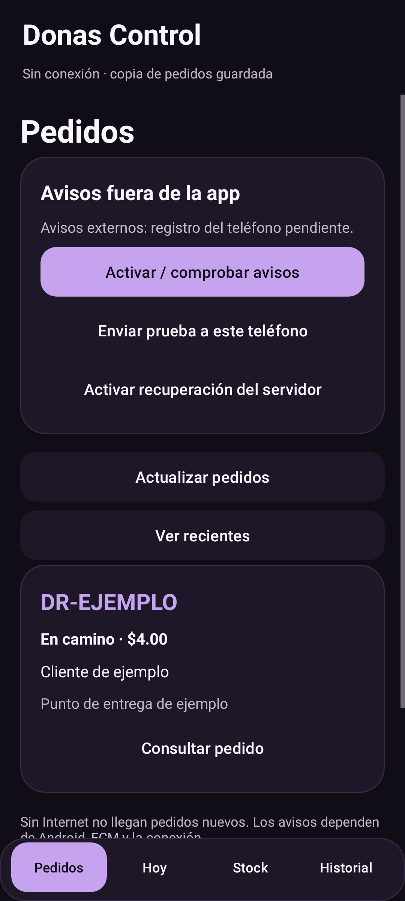
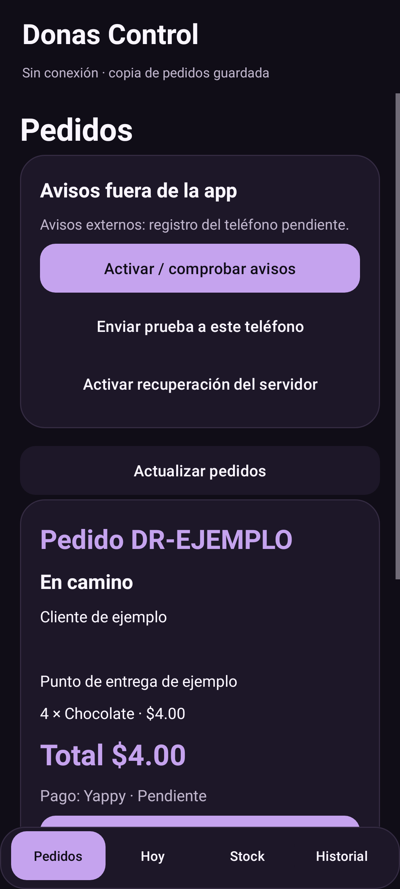

# Donas Control 2.1 — pedidos y avisos externos

## Cambio de alcance y diagnóstico previo

El usuario aclaró el 14 de octubre de 2026 que Pedidos y los avisos del sistema con pantalla bloqueada o app cerrada son prioridad, además del registro diario. Esto amplía la versión 2.0 y conserva compras, ventas, consumo, inventario y cierre. Supabase continúa siendo la autoridad comercial. Firebase se usa para FCM, sin inventario paralelo.

Confirmado en código2.0: manifest no registra FirebaseMessagingService; DonasApp cancela el sincronizador y registro históricos; endpoint devices responde410 y api/orders/index.js no dispara emisor tras confirmar la transacción. El usuario aportó new_order_push en preflight, pero una cola PostgreSQL no envía FCM por sí sola. Históricamente faltaban FCM_PROJECT_ID/FCM_CLIENT_EMAIL/FCM_PRIVATE_KEY en Vercel; se configuraron durante la activación2.1 descrita abajo. El permiso Android habilitado en Honor no resuelve por sí solo esas causas.

Firebase MCP confirmó proyecto donascontrol-1f5df, aplicación com.bryan.donas.control y certificado oficial. Se leyeron firebase-basics/firebase-auth-basics y documentación oficial de recepción/prioridad FCM. Firebase Auth anterior no se rehabilita: la cuenta ADMIN/SELLER Supabase existente autoriza cada registro y operación.

## Arquitectura implementada

Pedidos como entrada Android; caché Room separada por propietario y conservación de datos anteriores. Las acciones aceptar/en camino/cobrar-entregar/cancelar usan la API y transacciones web existentes. No se realiza un segundo descuento, cobro o alta contable Android.

Registro individual revocable del tokenFCM bajo sesión Supabase verificada, por un endpoint nuevo del router existente. Cola/tabla push existentes se reutilizan con marca de autorización nueva; registros históricos no se habilitan automáticamente. Alta de pedido confirma SQL antes de programar el envío del servidor. Mensajes de alta prioridad generan inmediatamente un aviso genérico con sonido/canal y PendingIntent al pedido; WorkManager recupera caché después, sin llamadas de red dentro del callback ni servicios permanentes.

UUID pedido/dispositivo y recibo local evitan repetición del mismo aviso. Token inválido se desactiva; rol o dispositivo revocado no recibe nuevos envíos. Cola persiste fallos, lease y backoff; un fallo de notificación conserva el pedido. Reintento de servidor requiere programación protegida; no se repone el workflow GitHub que enviaba errores por secretos faltantes.

## Validación y límites

Código y pantallas implementados. La compilación final pasó 117 pruebas Android, lintDebug/lintOfficial y assembleOfficial con R8. Los contratos de API, transporte FCM simulado, nueve suites SQL aisladas y ocho pruebas del índice documental pasaron localmente. GitHub aprobó web, navegador y concurrencia PostgreSQL en [CI de esta entrega](https://github.com/NotKingbryanPY/donas-racha/actions/runs/38619131794). La [compilación Android CI](https://github.com/NotKingbryanPY/donas-racha/actions/runs/38619131633), las migraciones y el inicio optimizado en emuladores API23/API35 pasaron sobre el código6f40f61. Un conjunto intermedio tuvo un timeout HTTP en MockWebServer; la repetición completa pasó sin cambiar la lógica ni aumentar el timeout de producción.

La recepción con app cerrada o pantalla bloqueada en Honor requiere prueba física y emisor FCM configurado. FCM, la red y Android pueden retrasar la entrega; detener forzosamente desde Ajustes exige volver a abrir. Wi-Fi o datos móviles sirven; offline no llegan pedidos nuevos. No se piden exclusiones generales de batería.

## APK e instalación

[Donas Control 2.1.0 oficial](https://www.dracha.store/downloads/Donas-Control-2.1.0-oficial.apk) · [SHA-256](https://www.dracha.store/downloads/Donas-Control-2.1.0-oficial.apk.sha256). Distribución firmada para instalación directa, distinta del artefacto CI firmado con una clave temporal de validación.

Paquete `com.bryan.donas.control`, versión 2.1.0/código16, mínimo Android6/API23, objetivo Android15/API35. Archivo final: 5,381,996 bytes. SHA-256 `1007e30dacdf1614dee5acd25f9acb0eaa333644d9f19f77cca749ab5d441af6`. Firma oficial v1/v2 verificada; certificado SHA-256 `5681a1329740c46b2c7a718e3e8a431951c7b6486fc625196dc3dd7ecadb249d`, coincidente con Firebase y la versión oficial anterior. Alineación de16KB válida. Escaneo de992 entradas sin claves privadas, cuentas de servicio, JWT service_role, keystores o bases locales empaquetadas; este escaneo no sustituye una auditoría completa.

Instalar sobre la versión oficial anterior sin desinstalar ni borrar datos. Room migra hasta7 conservando registros anteriores. Conectar una vez con la cuenta ADMIN/SELLER del Dashboard; la sesión se conserva. Pedidos abre primero y permite gestionar órdenes antes de activar FCM. Hoy, Stock e Historial mantienen compras, ventas, consumo y cierre. Para avisos externos completar la activación siguiente y comprobar el teléfono real.

[PR42](https://github.com/NotKingbryanPY/donas-racha/pull/42) integrado en main/db552f3. [Vercel Production](https://vercel.com/king-entertainment/donas-racha/8kL2SeJMZgPZwczfyubwpSpLFTaf) informó success. Verificación real del 14 octubre2026, 19:21UTC: página/panel diario, catálogo e inventario público HTTP200; pedidos, inventario administrativo, diario y registro de avisos anónimos HTTP401; despacho anónimo rechazado401; endpoints móviles retirados410. APK descargado del dominio con tamaño/hash idénticos; SHA, guía y SQL01 publicado completos y coincidentes. Es evidencia de despliegue/lectura pública, sin escritura privada ni aviso físico afirmados.

Fuentes: [recepción Android](https://firebase.google.com/docs/cloud-messaging/android/receive-messages), [prioridad FCM](https://firebase.google.com/docs/cloud-messaging/android-message-priority), [emisor HTTPv1](https://firebase.google.com/docs/cloud-messaging/send/v1-api), [tareas posteriores a respuesta Vercel](https://vercel.com/docs/functions/functions-api-reference/vercel-functions-package).

## Activación ordenada

El SQL diario ya dio DAILY_V2_READY según el usuario; no se repite. El 14 de octubre el usuario compartió el preflight compatible, confirmó Success para01 y aportó ORDER_NOTIFICATIONS_SQL_READY: protección de tablas/RPC, trigger de cola y ausencia de dispositivos activos revocados=true; registered_v2_devices=0. También compartió ORDER_RETRY_SUPPORT_INSTALLED para03. Esta evidencia valida la instalación SQL reportada, sin ejecución privada directa del agente. El emisor se configuró posteriormente; el soporte instalado no equivale a cron configurado ni entrega FCM: faltan registro del teléfono, activación de recuperación y prueba física.

| Orden | Archivo orders-v2 | Objetivo y dependencia | Riesgo/verificación |
|---|---|---|---|
| 0 | 00_preflight.sql | Solo lectura, un resultado con columnas/triggers, sin tokens. | Confirmar proyecto y objetos; si hay drift detener/revisar. |
| 1 | 01_apply.sql | Copia de migration202610140001; añade metadata y6 RPC, reutiliza cola, trigger y registros existentes. | Transacción, lock5s/statement60s. No modifica pedidos/stock/puntos ni activa dispositivosLEGACY. Termina END_STAFF_ORDER_NOTIFICATIONS_COMPLETE; copiar completo. |
| 2 | 02_verify.sql | Un resultado: RLS, RPC cerradas, trigger, revocación. | ORDER_NOTIFICATIONS_SQL_READY, checks true; registered_v2_devices puede0 antes de conectar APK. No certifica FCM. |
| 3 | 03_retry_scheduler.sql | Instala pg_cron/pg_net/Vault y helperADMIN privado; todavía no introduce un secreto. | Puede fallar si faltan permisos de extensión/net: rollback y compartir error, no abrir grants públicos. Net guarda headers descifrados; se revoca acceso cliente a schema/tablas/funciones. No cambia otros cron. |
| suspensión | 04_suspend.sql | Inactiva avisos nuevos y cron propio; conserva historia/negocio. | No revierte cobros ni stock. Reaplicar01 y registrar explícitamente teléfonos para reanudar; no bajar APK/Room7 a6. |

Ejecutar cada archivo completo en consulta nueva de Supabase SQL Editor. No seeds ni paquete02antiguo. No pegar claves FCM en SQL. Las tablas viejas pueden permanecer públicas protegidas o archivadas; ambos escenarios se probaron sin restaurar provisión/Firebase/sync contable.

El preflight muestra nombres, funciones y eventos de triggers, sin sus argumentos: un webhook puede guardar encabezados privados en ellos. No compartir definiciones completas ni resultados con credenciales. La prueba aislada verifica que un encabezado ficticio no aparece en el export.

## Configurar emisor protegido

Firebase existente donascontrol-1f5df, paquete com.bryan.donas.control y firma oficial ya verificados. FCM HTTPv1 necesita una cuenta de servicio con permiso de envío (Firebase Cloud Messaging API Admin en ese proyecto). No hace falta habilitar Blaze/Cloud Functions ni escribir compras en Firestore. Guardar únicamente en Vercel donas-racha/king-entertainment Production: FCM_PROJECT_ID, FCM_CLIENT_EMAIL, FCM_PRIVATE_KEY, CRON_SECRET aleatorio≥32 caracteres. Nunca ponerlos enAPK/frontend/Git ni enviar sus valores al chat.

CLI Vercel64 inicialmente verificó Logged out y Brave devolvió timeout al adjuntar pestaña. El usuario autorizó después la sesión CLI desde su navegador remoto. Se comprobó el proyecto king-entertainment/donas-racha y se ejecutó `scripts/configure-order-notifications.ps1 -ServiceAccountPath <ruta privada local>`: valida archivo/proyecto, transfiere valores por stdin(--sensitive), oculta salida cruda y no copia la cuenta servicio al repositorio. FCM_PROJECT_ID/FCM_CLIENT_EMAIL/FCM_PRIVATE_KEY/CRON_SECRET quedaron en Production; una lectura posterior verificó solamente sus nombres y entorno. Cada ejecución rota CRON_SECRET y exige volver a activar recuperación; no modifica variables Supabase.

[Redespliegue del emisor](https://vercel.com/king-entertainment/donas-racha/AfrY4noC81swx6pD3pW8qa7Y26Bs) Ready el14octubre20:12UTC, promovido a www.dracha.store desde el mismo código306ff96, sin cambiar runtime/APK. La credencial validó OAuth y una petición FCM HTTPv1 validate_only con HTTP200: cero avisos entregados por esa prueba. Web/catálogo/inventario HTTP200, pedidos/avisos/despacho anónimos401, rutas retiradas /api/admin/customers/devices y /api/sync410. La descarga APK conserva tamaño/hash anteriores. Falta probar validación desde la sesión del teléfono y recepción real.

El usuario adjuntó al chat una clave privada de cuenta de servicio. Se leyó solo para validación y transferencia protegida; no se volcó contenido a logs, guías, frontend, Git o APK. Su sustitución y revocación permanecen pendientes: la comprobación IAM no permitió verificar gestión de claves y no se concedieron privilegios adicionales ni se alteraron claves. Reemplazar por una credencial nueva enviada directamente al servidor, redesplegar, comprobar funcionamiento y deshabilitar/revocar la clave compartida, siguiendo la [rotación oficial](https://docs.cloud.google.com/iam/docs/key-rotation). No adjuntar la nueva clave al chat.

Tras SQL/emisor: instalarAPK2.1 como actualización sin borrar datos, entrar con cuentaSupabase ADMIN/SELLER, permitir notificaciones/canal; pulsar Activar/comprobar avisos. Una validación FCM exitosa reactiva jobs agotados del propio teléfono (pendientes<24h, sin lease activo), sin reenviar aceptados. ADMIN pulsa Activar recuperación del servidor: API guarda CRON_SECRET desde su entorno enVault y programa solo cron propio cada minuto, invocando únicamente cuando hay jobs elegibles. No viaja secreto por el cliente. Pulsar Enviar prueba a este teléfono y comprobar aviso real; FCM_ACCEPTED no basta.

## Recorrido de aceptación físico

Con un pedido real autorizado verificar app abierta, fuera de pantalla, segundo plano y teléfono bloqueado con Wi-Fi/datos; aviso con sonido, tap al UUID y estado. Repetir respuesta perdida sin otra orden/cobro/reserva/aviso. Aceptar→en camino→cobrado-entregado o cancelar también en camino; comprobar web/diario/puntos/stock únicos. Desconectar: no llegan pedidos nuevos; reconectar/abrir recupera activos. Probar sesión sin rol, token inválido y revocar avisos del teléfono; revocar avisos no revoca la cuentaSupabase ni recalls de mensajes ya aceptados. Para quitar acceso a datos, retirar rol/invalidate sesión enSupabase. No crear ventas/clientes ficticios en producción para aparentar pruebas.

Enlaces antiguos de notificación/widget a MainActivity/OrdersActivity se redirigen mediante alias a DailyActivity: no reactivan los escritores contables retirados. Se preserva su código/datos para recuperación.

Si un pedido ya tiene pago confirmado, Cobrado y entregado pide confirmar solo la entrega y conserva el método registrado; no vuelve a pedir un cobro ni permite cambiarlo silenciosamente.

El detalle toma la versión más nueva del pedido y la actualización vuelve a consultarlo por UUID, evitando que un objeto de detalle viejo oculte estados cambiados en la web.

Capturas renderizadas por pruebas Android, con datos de ejemplo, sin certificar conexión a producción:

