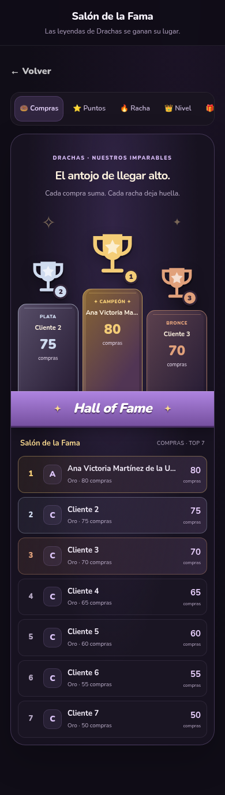
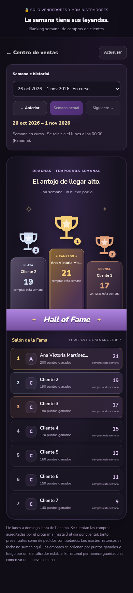

# Salón de la Fama y ranking semanal — 27 octubre 2026

Implementado en el repositorio; pendiente de aplicar SQL y publicar en producción.

El ranking público mantiene sus categorías (compras, puntos, racha, nivel y canjes) y su contrato sin IDs de acceso. La web y el perfil muestran un podio oro/plata/bronce, campeón elevado al centro, trofeos vectoriales propios y banda morada Hall of Fame, inspirado en la referencia del usuario. La lista sigue mostrando todas las posiciones. El resumen de inicio es compacto; los nombres largos se truncan visualmente, se escapan y mantienen su texto accesible. Pestañas descartan respuestas anteriores para no mezclar categorías.

El acceso `/?staff=weekly-ranking` aparece en el centro de ventas. Sin sesión conduce al login existente y vuelve a la vista solicitada al entrar. ADMIN y SELLER pueden consultar; clientes y anónimos no pueden obtener los datos. API `GET /api/admin/customers/weekly-ranking?week=YYYY-MM-DD` deriva el actor de Auth y de `app_user_roles`, limita frecuencia y responde no-store. El lunes seleccionado se conserva en la URL para recarga y enlace directo. Incluye historial, semana anterior/siguiente, semana actual y actualización manual. Al salir o cerrar sesión se limpia el DOM y se descartan respuestas tardías.

## Regla SQL

`api_staff_weekly_ranking(uuid,date,integer)` lee `loyalty_transactions` y `customers`. Solo service_role tiene EXECUTE y el RPC también valida ADMIN/SELLER. La fecha por defecto es el lunes de la semana actual en `America/Panama`; intervalo [lunes 00:00, lunes siguiente 00:00). Una fecha no lunes o futura se rechaza. Máximo 100 participantes; UI muestra TOP 100 si se alcanza ese límite. Orden: compras descendentes, puntos de esas compras descendentes y UUID de cliente estable. No se ofrecen empates aleatorios.

Cada `PURCHASE_EARN` cuenta una compra. Se conservan los límites actuales de fidelidad (3 compras acreditadas al día, presenciales o de pedidos completados), replay/idempotencia y puntos existentes. No se cuentan donas por unidad, ventas anónimas del libro diario, pedidos pendientes/cancelados, canjes ni ADJUSTMENT/HISTORICAL_PURCHASES sin fecha. No se inventan fechas a partir del contador acumulado.

El historial vive en los registros fechados que PostgreSQL ya conserva. Se reconstruye por semana, incluyendo semanas antiguas con clientes después desactivados; no se guarda una segunda copia de saldos ni se elimina el ledger. Al cambiar de lunes el intervalo es nuevo y arranca vacío sin cron ni tarea de borrado. El selector incluye todas las semanas con compras, la actual y la solicitada; Anterior/Siguiente permiten consultar semanas vacías. Un nombre editado se ve actualizado también en historia: no se promete un snapshot congelado de nombres. Una importación o corrección directa autorizada del ledger puede cambiar el resultado histórico.

## Activación

1. En el proyecto Supabase vigente, ejecutar [preflight de solo lectura](../supabase/sql-editor/weekly-ranking/00_preflight.sql). Los primeros cuatro controles deben ser true. Si weekly_installed ya es true, revisar primero la verificación.
2. Aplicar exclusivamente [202610270001_weekly_ranking.sql](../supabase/migrations/202610270001_weekly_ranking.sql). Es una transacción: crea un índice parcial y el RPC, sin UPDATE/DELETE de registros comerciales, seeds ni nuevos grants a clientes. Tiene límite de espera de lock de 5 s y de sentencia de 60 s. No repetir las migraciones antiguas ni paquetes móviles.
3. Ejecutar [verificación de solo lectura](../supabase/sql-editor/weekly-ranking/02_verify.sql): todas las columnas deben ser true.
4. Publicar la rama revisada en el hosting existente y recorrer el enlace privado con una sesión SELLER y ADMIN. Comprobar también acceso anónimo y un cliente sin rol. Si falta SQL, la API devuelve 503/WEEKLY_RANKING_SETUP_REQUIRED y la web lo muestra explícitamente.

No se requiere configurar cron, secretos nuevos, otra base ni modificar Android/stock/pagos. La publicación y ejecución SQL privada no quedan verificadas por las pruebas locales.

## Evidencia local

`weekly-ranking-postgres.mjs` aplica todas las migraciones en PGlite aislado y verifica cambio domingo/lunes Panamá, conteos por semana, replay, historial tras nueva compra/desactivación, semanas vacías, permisos y scripts de activación. `weekly-ranking-api.cjs` verifica login/roles, suplantación del actor, fechas inválidas, método y no-store. `rankings-web.cjs` verifica DOM real a 320/390/768/1280 px, orden/altura del podio, privacidad, login/enlace/recarga/historial, listas vacías/1/2 participantes, escape de nombres y respuesta tardía tras logout. CI incluye los tres.

Capturas con datos simulados, no datos de clientes reales:

